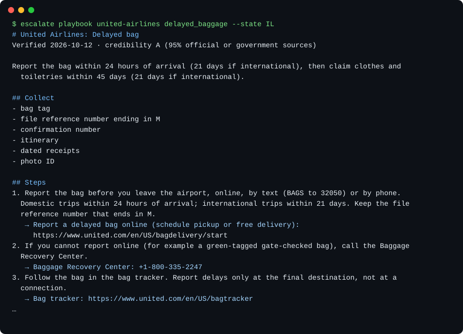
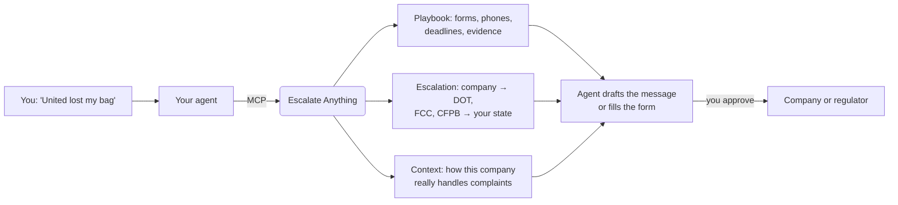

<!-- mcp-name: io.github.alexgaoth/escalate-anything -->
<div align="center">

# Escalate Anything

### Get the upper hand on any big company when they wrong you.

**Big companies count on you giving up. This repo will make your agent hunt them down.**

Bill went up? Bag lost? Refund denied? Your agent knows who to contact, what to say, and when to escalate.

[](https://intro.alexgaoth.com/escalate-anything/)
[](docs/maintenance.md)
[](https://intro.alexgaoth.com/escalate-anything/#/guides)
[](https://pypi.org/project/escalate-anything/)
[](https://github.com/alexgaoth/escalate-anything/actions/workflows/pr-gate.yml)
[](docs/clients.md)
[](LICENSE)

**[Website](https://intro.alexgaoth.com/escalate-anything/) · [Guides](https://intro.alexgaoth.com/escalate-anything/#/guides)**

Every playbook has its own page, for example [United Airlines: delayed bag](https://intro.alexgaoth.com/escalate-anything/c/united-airlines/delayed-baggage/).

[Quick start](#quick-start) · [How it works](#how-escalate-anything-works) · [What you can fix](#what-you-can-fix) · [Walkthroughs](#walkthroughs) · [Fresh and credible](#fresh-and-credible) · [FAQ](#faq)

<code>uvx escalate-anything setup</code>

<br />



</div>

---

Tell your agent what went wrong. Escalate Anything gives it the company's real playbook: the exact form, phone line and deadline, the evidence to collect, the rules that apply, and the escalation ladder up to the regulator in your state. Your agent keeps a case log, follows up on time, and drafts each message for you to approve.

Every value links to the page it came from, with the date it was checked. A weekly routine re-checks the data, and your installed copy updates itself.

## Quick start

### Set up your agent

With [uv](https://docs.astral.sh/uv/) installed, run:

```bash
uvx escalate-anything setup
```

It finds your AI apps (Claude Desktop, Claude Code, Cursor, VS Code, Windsurf, Zed, Gemini CLI, Codex, LM Studio and [more](docs/clients.md)), shows the changes, and asks before writing. Each config is backed up first. Restart your app afterward.

Or install with one click: [Cursor](https://cursor.com/install-mcp?name=escalate-anything&config=eyJjb21tYW5kIjoidXZ4IiwiYXJncyI6WyJlc2NhbGF0ZS1hbnl0aGluZyJdfQ%3D%3D) · [VS Code](https://insiders.vscode.dev/redirect/mcp/install?name=escalate-anything&config=%7B%22type%22%3A%22stdio%22%2C%22command%22%3A%22uvx%22%2C%22args%22%3A%5B%22escalate-anything%22%5D%7D) · [LM Studio](https://lmstudio.ai/install-mcp?name=escalate-anything&config=eyJjb21tYW5kIjoidXZ4IiwiYXJncyI6WyJlc2NhbGF0ZS1hbnl0aGluZyJdfQ%3D%3D) · [Goose](https://block.github.io/goose/extension?cmd=uvx&arg=escalate-anything&id=escalate-anything&name=escalate-anything&description=Contacts%2C+playbooks+and+escalation+paths+to+get+US+companies+to+fix+problems). Claude Code users can add the plugin, which also includes the skills: `claude plugin marketplace add alexgaoth/escalate-anything && claude plugin install escalate-anything@escalate-anything`.

### Ask your agent

```text
United lost my bag on Friday's ORD→SFO flight. Use Escalate Anything to get me reimbursed.
```

```text
My internet bill went from $80 to $105. Get it back down.
```

### Use the terminal

```bash
uvx escalate-anything playbook comcast-xfinity bill_increase --state CA
uvx escalate-anything playbook united-airlines delayed_baggage --state IL
uvx escalate-anything lookup "spectrum"
```

No install at all? Browse every company's playbooks on the website: **[intro.alexgaoth.com/escalate-anything](https://intro.alexgaoth.com/escalate-anything/)**.

## How Escalate Anything works



Escalate Anything never sends, submits or pays anything. Your agent drafts; you approve. Case notes stay on your computer.

## What you can fix

| Area | What you get | Companies |
|---|---|---|
| ✈️ Travel | Refunds, cancellations, lost and delayed bags, damage claims, DOT complaints | United, American, Delta, Southwest, Marriott, Airbnb, Expedia, Hertz |
| 🚢 Cruises & 🎟️ tickets | Cancelled events and sailings, fees, refunds, FMC and FTC complaints | Carnival, Royal Caribbean, Norwegian, Ticketmaster, StubHub, SeatGeek |
| 📱 Phone, internet, TV | Bill increases, retention offers, cancellation, equipment returns, FCC complaints | AT&T, Verizon, T-Mobile, Xfinity, Spectrum, Optimum, DIRECTV, Starlink |
| 🏦 Money | Card and transfer disputes, fraud, frozen accounts, buy-now-pay-later, credit report errors | Chase, Bank of America, Wells Fargo, Capital One, Chime, SoFi, PayPal, Affirm, Equifax |
| 📈 Investing & crypto | Blocked transfers and withdrawals, account takeovers, FINRA and SEC complaints | Robinhood, Fidelity, Schwab, Vanguard, Coinbase, Kraken |
| 📨 Debt collectors | Validation notices, disputes in writing, credit report fixes | Portfolio Recovery, Midland Credit, LVNV, Jefferson Capital |
| ⚡ Utilities | High bills, meter tests, shutoff protection, payment plans, outage claims | PG&E, Con Edison, Duke, ComEd, FPL, PPL, FirstEnergy and dozens more |
| 🏠 Home services | Long contracts, early termination fees, cancelling in writing, door-to-door sales | ADT, Vivint, SimpliSafe, Brinks Home, Terminix, Orkin |
| 🩺 Insurance | Claim denials, appeals, external review, surprise medical bills | UnitedHealthcare, Aetna, Cigna, Kaiser, State Farm, GEICO, Progressive |
| 🛒 Shopping & subscriptions | Returns, missing packages, price adjustments, cancellations, free-trial charges, auto-renewals | Amazon, Walmart, Apple, Netflix, SiriusXM, Adobe, Norton, Peloton, Planet Fitness |
| 🏛️ Regulators | The right federal agency and **your state's** attorney general, utility commission and insurance department | All 50 states and DC |

[Browse all companies →](https://intro.alexgaoth.com/escalate-anything/)

## Walkthroughs

### A delayed United bag

The playbook in the image above, from United's own pages: report within **24 hours** (21 days if international), claim expenses within **45 days**, use the exact claim form and the Baggage Recovery Center number, and check the **automatic bag-fee refund** owed after a 12-hour domestic delay under the DOT refund rule. If United doesn't answer, the next rung is a DOT complaint.

### An internet bill that jumped $25

The Xfinity playbook checks whether a promotion ended or the 5-Year Price Guarantee was broken, then gives the retention line, the dispute window from the subscriber agreement, and the FCC complaint as the next rung.

Also included, as a side feature: each company's scam warnings (what it says it will never ask for, scams that use its name, where to report them), a [scam guide](https://intro.alexgaoth.com/escalate-anything/#/guides/scams), and `scam_check` for a quick red-flag read of a suspicious message.

Got a result with Escalate Anything? **[Share what worked](https://github.com/alexgaoth/escalate-anything/issues/new?template=share-your-case.yml)**: good cases become tactics for the next person.

## Fresh and credible

- **Every value has a source and a date.** Every company gets a credibility grade (A, B or C) from how much of its data comes from its own pages or government sites, and from what was only seen in a search snippet or an archive.
- **Agents see it too.** Each answer says when the company was last verified and how credible it is.
- **A weekly routine keeps it current.** It checks every link, opens a [freshness report](https://github.com/alexgaoth/escalate-anything/issues?q=label%3Afreshness), and a Claude routine re-verifies stale values and proposes fixes as pull requests. Maintainers review every change.
- **Your copy updates itself** once a week (`escalate update`; `ESCALATE_OFFLINE=1` to turn it off).

How it works: [docs/maintenance.md](docs/maintenance.md).

## Contribute

- **A number or link is wrong?** [Report it](https://github.com/alexgaoth/escalate-anything/issues/new?template=data-correction.yml). A maintainer labels it, and the routine checks it against the official page and opens the fix.
- **Something worked for you?** [Share your case](https://github.com/alexgaoth/escalate-anything/issues/new?template=share-your-case.yml).
- **Want a company added?** [Ask for it](https://github.com/alexgaoth/escalate-anything/issues/new?template=new-company.yml), or add the YAML yourself; see [CONTRIBUTING.md](CONTRIBUTING.md).

## FAQ

<details>
<summary><strong>Which agents can use Escalate Anything?</strong></summary>

Any app that supports MCP: `uvx escalate-anything setup` configures the [supported apps](docs/clients.md). ChatGPT and claude.ai need a remote URL; run the read-only server with the included Dockerfile. Agents without MCP can read the website's JSON and [`llms.txt`](https://intro.alexgaoth.com/escalate-anything/llms.txt).
</details>

<details>
<summary><strong>Does Escalate Anything contact companies or pay anything for me?</strong></summary>

No. It gives your agent the facts and the playbook. Your agent drafts messages or fills forms, and you approve each one before it is sent. Escalate Anything never handles passwords or payment details.
</details>

<details>
<summary><strong>Where does my case data go?</strong></summary>

The case log and bill history live in `~/.escalate-anything` on your computer. Escalate Anything refuses to store full card numbers or SSNs. The weekly data update downloads a public archive from GitHub and sends nothing about you. Your agent's model provider has its own data policy.
</details>

<details>
<summary><strong>How current is the data, and can I trust it?</strong></summary>

Each company shows its last-verified date and credibility grade; every value links to its source. Data changes, so check the source before you rely on a value. See [Fresh and credible](#fresh-and-credible).
</details>

<details>
<summary><strong>Is this legal advice?</strong></summary>

No. Escalate Anything summarizes public pages from companies and government agencies and links to them. Rules have a status (in force, vacated, repealed) so agents don't cite dead ones, but it is not a lawyer.
</details>

<details>
<summary><strong>Does it work outside the US?</strong></summary>

Not yet. Companies, rules and regulators are US-only. Contributions for other countries are welcome.
</details>

## Wins

Got a company to fix something? [Share a win](https://github.com/alexgaoth/escalate-anything/issues/new?template=share-your-case.yml) and see [what worked for others](docs/wins.md). `uvx escalate-anything cases <id> --story` turns your case log into a write-up without reference numbers or names.

## Star history

If Escalate Anything got you a refund or a fix, a star helps the next person find it.

<a href="https://star-history.com/#alexgaoth/escalate-anything&Date">
  <picture>
    <source media="(prefers-color-scheme: dark)" srcset="https://api.star-history.com/svg?repos=alexgaoth/escalate-anything&type=Date&theme=dark">
    
  </picture>
</a>

## License

Code: [MIT](LICENSE). Data in `registry/`: [CC BY 4.0](registry/LICENSE.md); please credit "Escalate Anything". Not affiliated with any company it lists.
