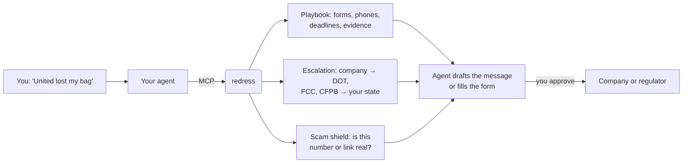
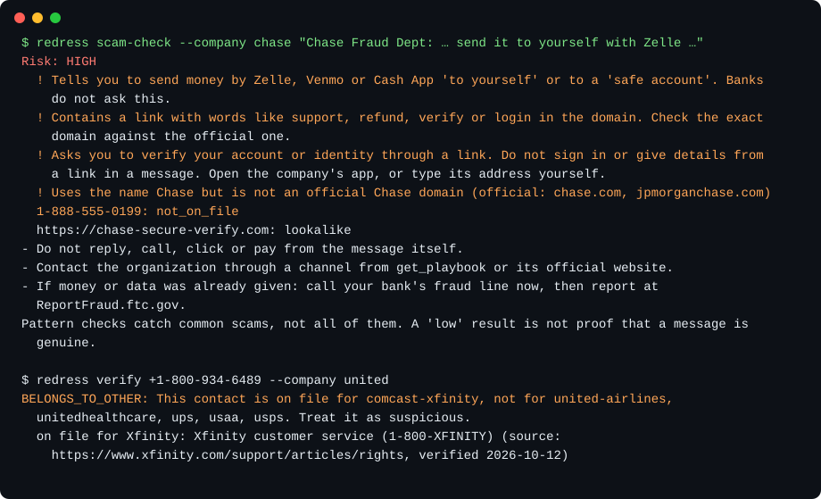

<!-- mcp-name: io.github.alexgaoth/redress -->
<div align="center">

# Redress: Get It Fixed

### One MCP to get any big company to fix it, without getting scammed.

**Bill went up? Bag lost? Refund denied? Your agent knows who to contact, what to say, when to escalate, and which "support number" is a scam.**

[](https://alexgaoth.github.io/redress/)
[](docs/maintenance.md)
[](https://alexgaoth.github.io/redress/#/guides)
[](https://pypi.org/project/redress-mcp/)
[](https://github.com/alexgaoth/redress/actions/workflows/pr-gate.yml)
[](docs/clients.md)
[](LICENSE)

**[Website](https://alexgaoth.github.io/redress/) · [Check a number before you call](https://alexgaoth.github.io/redress/#/check) · [Scam guide](https://alexgaoth.github.io/redress/#/guides/scams)**

[Quick start](#quick-start) · [How it works](#how-redress-works) · [What you can fix](#what-you-can-fix) · [Walkthroughs](#walkthroughs) · [Fresh and credible](#fresh-and-credible) · [FAQ](#faq)

<code>uvx redress-mcp setup</code>

<br />


</div>

---

Tell your agent what went wrong. redress gives it the company's real playbook: the exact form, phone line and deadline, the evidence to collect, the rules that apply, and the escalation ladder up to the regulator in your state. Before your agent calls a number it found online, redress checks whether it really belongs to that company.

Every value links to the page it came from, with the date it was checked. A weekly routine re-checks the data, and your installed copy updates itself.

## Quick start

### Set up your agent

With [uv](https://docs.astral.sh/uv/) installed, run:

```bash
uvx redress-mcp setup
```

<sub>Before the first PyPI release, use `uvx --from git+https://github.com/alexgaoth/redress redress-mcp setup`.</sub>

It finds your AI apps (Claude Desktop, Claude Code, Cursor, VS Code, Windsurf, Zed, Gemini CLI, Codex, LM Studio and [more](docs/clients.md)), shows the changes, and asks before writing. Each config is backed up first. Restart your app afterward.

Or install with one click: [Cursor](https://cursor.com/install-mcp?name=redress&config=eyJjb21tYW5kIjoidXZ4IiwiYXJncyI6WyJyZWRyZXNzLW1jcCJdfQ%3D%3D) · [VS Code](https://insiders.vscode.dev/redirect/mcp/install?name=redress&config=%7B%22type%22%3A%22stdio%22%2C%22command%22%3A%22uvx%22%2C%22args%22%3A%5B%22redress-mcp%22%5D%7D) · [LM Studio](https://lmstudio.ai/install-mcp?name=redress&config=eyJjb21tYW5kIjoidXZ4IiwiYXJncyI6WyJyZWRyZXNzLW1jcCJdfQ%3D%3D) · [Goose](https://block.github.io/goose/extension?cmd=uvx&arg=redress-mcp&id=redress&name=redress&description=Verified+contacts%2C+playbooks+and+scam+checks+for+US+companies). Claude Code users can add the plugin, which also includes the skills: `claude plugin marketplace add alexgaoth/redress && claude plugin install redress@redress`.

### Ask your agent

```text
United lost my bag on Friday's ORD→SFO flight. Use redress to get me reimbursed.
```

```text
Is this text from USPS real? "Your package is held, pay a $1.99 redelivery fee at usps-redelivery-fee.com"
```

### Use the terminal

```bash
uvx redress-mcp playbook comcast-xfinity bill_increase --state CA
uvx redress-mcp verify "+1-888-555-0199" --company united-airlines
uvx redress-mcp scam-check "Chase: your account is locked, send your money to yourself with Zelle"
```

No install at all? Use the website: **[alexgaoth.github.io/redress](https://alexgaoth.github.io/redress/)**. The number checker runs in your browser and sends nothing.

## How redress works



redress never sends, submits or pays anything. Your agent drafts; you approve. Case notes stay on your computer.

## What you can fix

| Area | What you get | Companies |
|---|---|---|
| ✈️ Travel | Refunds, cancellations, lost and delayed bags, damage claims, DOT complaints | United, American, Delta, Southwest, Marriott, Airbnb, Expedia, Hertz, cruise lines |
| 📱 Phone, internet, TV | Bill increases, retention offers, cancellation, equipment returns, FCC complaints | AT&T, Verizon, T-Mobile, Xfinity, Spectrum, Optimum, DIRECTV, Starlink |
| 🏦 Money | Card and transfer disputes, fraud, frozen accounts, credit report errors, debt collectors | Chase, Bank of America, Wells Fargo, Capital One, PayPal, Cash App, Equifax |
| ⚡ Utilities | High bills, meter tests, shutoff protection, payment plans, outage claims | PG&E, Con Edison, Duke, ComEd, FPL, TXU and dozens more |
| 🩺 Insurance | Claim denials, appeals, external review, surprise medical bills | UnitedHealthcare, Aetna, Cigna, Kaiser, State Farm, GEICO, Progressive |
| 🛒 Shopping & subscriptions | Returns, missing packages, price adjustments, cancellations, free-trial charges | Amazon, Walmart, Apple, Netflix, SiriusXM, Adobe, Planet Fitness |
| 🛡️ Scams | Is this call, text, email or link real? What will this company never ask for? | Every company, plus look-alike domain detection |
| 🏛️ Regulators | The right federal agency and **your state's** attorney general, utility commission and insurance department | All 50 states and DC |

[Browse all companies →](https://alexgaoth.github.io/redress/)

## Walkthroughs

### A delayed United bag

The playbook in the image above, from United's own pages: report within **24 hours** (21 days if international), claim expenses within **45 days**, use the exact claim form and the Baggage Recovery Center number, and check the **automatic bag-fee refund** owed after a 12-hour domestic delay under the DOT refund rule. If United doesn't answer, the next rung is a DOT complaint.

### A fake "USPS" text



`scam_check` flags the package-fee pattern and the look-alike domain (`usps-redelivery-fee.com` imitates USPS, whose only official domain is usps.com). `verify_contact` shows that a "United" number actually belongs to Xfinity.

### An internet bill that jumped $25

The Xfinity playbook checks whether a promotion ended or the 5-Year Price Guarantee was broken, then gives the retention line, the dispute window from the subscriber agreement, and the FCC complaint as the next rung.

Got a result with redress? **[Share what worked](https://github.com/alexgaoth/redress/issues/new?template=share-your-case.yml)**: good cases become tactics for the next person.

## Fresh and credible

- **Every value has a source and a date.** Every company gets a credibility grade (A, B or C) from how much of its data comes from its own pages or government sites, and from what was only seen in a search snippet or an archive.
- **Agents see it too.** Each answer says when the company was last verified and how credible it is.
- **A weekly routine keeps it current.** It checks every link, opens a [freshness report](https://github.com/alexgaoth/redress/issues?q=label%3Afreshness), and a Claude routine re-verifies stale values and proposes fixes as pull requests. Maintainers review every change.
- **Your copy updates itself** once a week (`redress update`; `REDRESS_OFFLINE=1` to turn it off).

How it works: [docs/maintenance.md](docs/maintenance.md).

## Contribute

- **A number or link is wrong?** [Report it](https://github.com/alexgaoth/redress/issues/new?template=data-correction.yml). A maintainer labels it, and the routine checks it against the official page and opens the fix.
- **Something worked for you?** [Share your case](https://github.com/alexgaoth/redress/issues/new?template=share-your-case.yml).
- **Want a company added?** [Ask for it](https://github.com/alexgaoth/redress/issues/new?template=new-company.yml), or add the YAML yourself; see [CONTRIBUTING.md](CONTRIBUTING.md).

## FAQ

<details>
<summary><strong>Which agents can use redress?</strong></summary>

Any app that supports MCP: `uvx redress-mcp setup` configures the [supported apps](docs/clients.md). ChatGPT and claude.ai need a remote URL; run the read-only server with the included Dockerfile. Agents without MCP can read the website's JSON and [`llms.txt`](https://alexgaoth.github.io/redress/llms.txt).
</details>

<details>
<summary><strong>Does redress contact companies or pay anything for me?</strong></summary>

No. It gives your agent the facts and the playbook. Your agent drafts messages or fills forms, and you approve each one before it is sent. redress never handles passwords or payment details.
</details>

<details>
<summary><strong>Where does my case data go?</strong></summary>

The case log and bill history live in `~/.redress` on your computer. redress refuses to store full card numbers or SSNs. The weekly data update downloads a public archive from GitHub and sends nothing about you. Your agent's model provider has its own data policy.
</details>

<details>
<summary><strong>How current is the data, and can I trust it?</strong></summary>

Each company shows its last-verified date and credibility grade; every value links to its source. Data changes, so check the source before you rely on a value. See [Fresh and credible](#fresh-and-credible).
</details>

<details>
<summary><strong>Is this legal advice?</strong></summary>

No. redress summarizes public pages from companies and government agencies and links to them. Rules have a status (in force, vacated, repealed) so agents don't cite dead ones, but it is not a lawyer.
</details>

<details>
<summary><strong>Does it work outside the US?</strong></summary>

Not yet. Companies, rules and regulators are US-only. Contributions for other countries are welcome.
</details>

## Star history

<a href="https://star-history.com/#alexgaoth/redress&Date">
  <picture>
    <source media="(prefers-color-scheme: dark)" srcset="https://api.star-history.com/svg?repos=alexgaoth/redress&type=Date&theme=dark">
    
  </picture>
</a>

## License

Code: [MIT](LICENSE). Data in `registry/`: [CC BY 4.0](registry/LICENSE.md); please credit "redress". Not affiliated with any company it lists.
