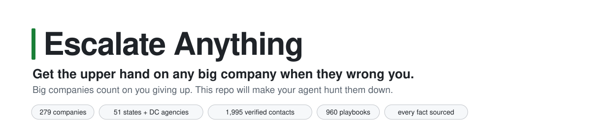
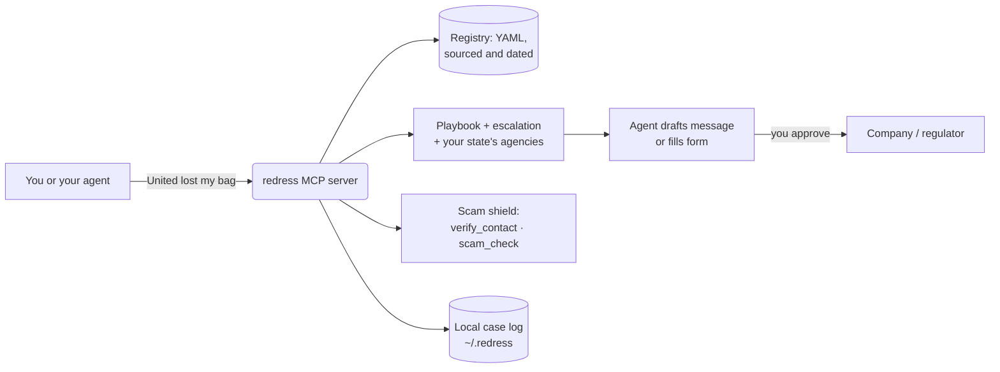

<!-- mcp-name: io.github.alexgaoth/redress -->
<p align="center">
  <picture>
    <source media="(prefers-color-scheme: dark)" srcset="docs/assets/banner-dark.svg">
    
  </picture>
</p>

<p align="center">
  <a href="https://github.com/alexgaoth/redress/actions/workflows/pr-gate.yml"></a>
  <a href="https://pypi.org/project/redress-mcp/"></a>
  
  <a href="https://modelcontextprotocol.io"></a>
  <a href="LICENSE"></a>
  <a href="registry/LICENSE.md"></a>
  <a href="https://github.com/alexgaoth/redress/stargazers"></a>
</p>

<p align="center">
  <a href="https://cursor.com/install-mcp?name=redress&config=eyJjb21tYW5kIjoidXZ4IiwiYXJncyI6WyJyZWRyZXNzLW1jcCJdfQ%3D%3D"></a>
  <a href="https://insiders.vscode.dev/redirect/mcp/install?name=redress&config=%7B%22type%22%3A%22stdio%22%2C%22command%22%3A%22uvx%22%2C%22args%22%3A%5B%22redress-mcp%22%5D%7D"></a>
  <a href="https://lmstudio.ai/install-mcp?name=redress&config=eyJjb21tYW5kIjoidXZ4IiwiYXJncyI6WyJyZWRyZXNzLW1jcCJdfQ%3D%3D"></a>
  <a href="https://block.github.io/goose/extension?cmd=uvx&arg=redress-mcp&id=redress&name=redress&description=Verified+contacts%2C+playbooks+and+scam+checks+for+US+companies"></a>
</p>

<p align="center">
  <b><a href="https://alexgaoth.github.io/redress/">Browse the directory</a></b> ·
  <a href="#quick-start">Quick start</a> ·
  <a href="docs/clients.md">Connect your app</a> ·
  <a href="#what-your-agent-gets">Tools</a> ·
  <a href="CONTRIBUTING.md">Fix a value</a>
</p>

---

Your airline lost your bag. Your internet bill jumped $25. Your bank won't reverse a charge. You know the drill: hold music, a chatbot that loops, a "case closed" email. And when you search for the company's number, the top result might belong to a scammer.

**redress** is an open, sourced index of *how to actually get things fixed* with the largest companies Americans deal with: the exact form, phone line, deadline, evidence, escalation ladder and regulator for each problem, plus the scams that impersonate each company. It ships as an **MCP server**, so Claude, ChatGPT, Cursor, VS Code, Gemini, Codex and other agents can use it. It also has a CLI and a website for people.

## See it work

<p align="center"></p>

Every step links to the real page, every fact has a source and a check date, and the ladder ends at the regulator that applies in *your* state.

<p align="center"></p>

Before your agent calls a number it found online, `verify_contact` checks it against every company, regulator and state agency in the registry. `scam_check` flags the patterns that cost people the most money.

## Quick start

**Claude Code** (MCP server + 5 skills):

```bash
claude plugin marketplace add alexgaoth/redress
claude plugin install redress@redress
```

**Any other MCP app.** redress finds your apps and adds itself. It backs up each config and never clobbers your settings:

```bash
uvx --from redress-mcp redress install --all
```

Or add `uvx redress-mcp` by hand. [Per-app instructions](docs/clients.md) cover Claude Desktop, Cursor, VS Code, Windsurf/Devin, Cline, Zed, Gemini CLI, Codex, Goose, LM Studio, Continue and JetBrains. For **ChatGPT** and **claude.ai**, run the read-only HTTP server ([Dockerfile](Dockerfile)) and add its URL as a custom connector.

**No AI needed:**

```bash
uvx --from redress-mcp redress playbook united-airlines delayed_baggage --state CA
uvx --from redress-mcp redress verify "+1-888-555-0199" --company united
```

Then ask your agent things like:

> *United lost my bag on Friday's ORD→SFO flight. Get me reimbursed.*
> *My Xfinity bill went from $80 to $105. Get it back down.*
> *Is this text from "USPS" real?*
> *Check my email for bills that went up this year.*

## What your agent gets

| | |
|---|---|
| 🗺️ **Playbooks** | `get_playbook(company, issue, state)`: steps with deep links, phone numbers, evidence to collect, deadlines, and the company's own rules, for 54 issue types. |
| 🪜 **Escalation ladders** | Frontline → written complaint → executive → federal regulator → **your state's** attorney general, utility commission or insurance department → card dispute → arbitration or small claims. |
| ⚖️ **Rules with status** | 30 consumer rules (DOT refunds, Fair Credit Billing Act, Reg E, No Surprises Act, …) marked in force, vacated or repealed. Agents never cite a dead rule. |
| 🛡️ **Scam shield** | `verify_contact`, `scam_check`, and per-company official domains, "we will never ask you for …", and how to report phishing. |
| 🧭 **Context** | `get_context(company)`: cited dossiers on how each company handles complaints in practice, plus industry guides and a scam guide. |
| 📒 **Case log** | A local timeline of reference numbers, names, promises and follow-up dates; `draft_brief` turns it into a short, sourced, polite message. It stays on your machine. |
| 📈 **Bill watch** | `bill_record` and `bill_check` flag bills that went up and promotions about to end. |
| 🧩 **Prompts & skills** | `resolve`, `negotiate-bill`, `regulator-complaint`, `bill-watch` and `scam-check`, as Claude Code skills and as MCP prompts for every other app. |

**Agents draft; you decide.** The tools never send, submit or pay anything. The skills require your approval for every message and form, tell agents to identify themselves as AI on chats and calls, and hand sign-ins and CAPTCHAs back to you.

## Coverage

| Sector | Companies | Examples |
|---|---:|---|
| ✈️ Airlines | 11 | United, American, Delta, Southwest, Alaska, JetBlue |
| 📱 Wireless | 12 | AT&T, Verizon, T-Mobile, Cricket, Mint, Google Fi |
| 📺 Internet, cable & satellite | 14 | Xfinity, Spectrum, Optimum, Frontier, DIRECTV, Starlink |
| ⚡ Electric & gas utilities | 30 | PG&E, Con Edison, Duke, Dominion, FPL, ComEd, TXU |
| 🏦 Banks, cards & credit unions | 16 | Chase, Bank of America, Wells Fargo, Citi, Capital One, Amex |
| 💸 Payment apps | 9 | PayPal, Venmo, Cash App, Zelle, Western Union |
| 📄 Credit bureaus & student loans | 8 | Equifax, Experian, TransUnion, MOHELA, Nelnet, Aidvantage |
| 🩺 Health insurance | 10 | UnitedHealthcare, Anthem/Elevance, Aetna, Cigna, Kaiser |
| 🚗 Auto & home insurance | 9 | State Farm, GEICO, Progressive, Allstate, Liberty Mutual |
| 🛒 Retail & marketplaces | 16 | Amazon, Walmart, Target, Costco, Best Buy, eBay, Temu |
| 🎬 Subscriptions & gyms | 22 | Netflix, Spotify, Disney+, SiriusXM, Adobe, Planet Fitness |
| 🏨 Travel | 21 | Marriott, Hilton, Airbnb, Expedia, Booking.com, Hertz, Amtrak |
| 📦 Delivery & shipping | 10 | USPS, UPS, FedEx, Uber, DoorDash, Instacart |

Plus all **18 federal regulators** consumers use (DOT, FCC, CFPB, FTC, OCC, CMS and others) and complaint agencies for **all 50 states and DC**. [Browse everything →](https://alexgaoth.github.io/redress/)

## How it works



The data lives in [`registry/`](registry) as plain YAML and Markdown. Every channel, fact and rule has a `source` URL and a `last_verified` date. A [JSON Schema](schema/redress.schema.json) and a validator check every change. A weekly [freshness job](.github/workflows/freshness.yml) checks every link and lists values older than 180 days. The research was done by AI agents reading official pages, and pages that block bots were read in a real browser. Anything taken only from a search snippet is marked as such.

## Contributing

The most valuable contribution is a correction: a phone number that changed, a form that moved, a deadline that is wrong, or a tactic that worked for you (with a source). [Open a data correction](https://github.com/alexgaoth/redress/issues/new?template=data-correction.yml) or edit the YAML and open a PR; see [CONTRIBUTING.md](CONTRIBUTING.md) and the [authoring guide](docs/authoring.md).

## Star history

<a href="https://star-history.com/#alexgaoth/redress&Date">
  <picture>
    <source media="(prefers-color-scheme: dark)" srcset="https://api.star-history.com/svg?repos=alexgaoth/redress&type=Date&theme=dark">
    
  </picture>
</a>

## License and disclaimer

Code: [MIT](LICENSE). Data in `registry/`: [CC BY 4.0](registry/LICENSE.md). Please credit "redress".

redress is not a law firm and this is not legal advice. Facts summarize public pages, which change; check the linked source before you rely on it. redress is not affiliated with any company it lists.
